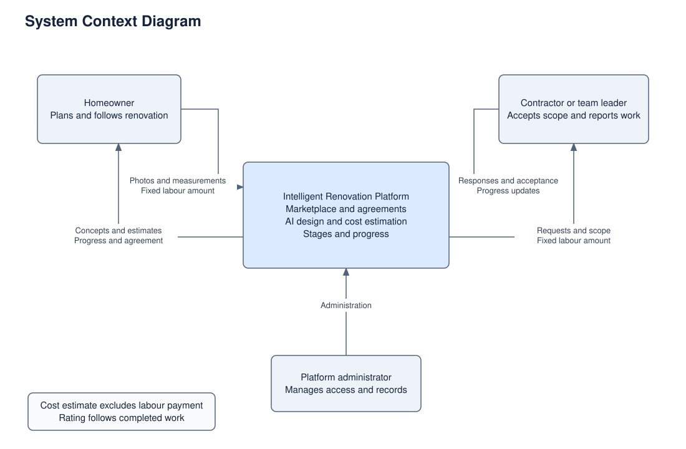
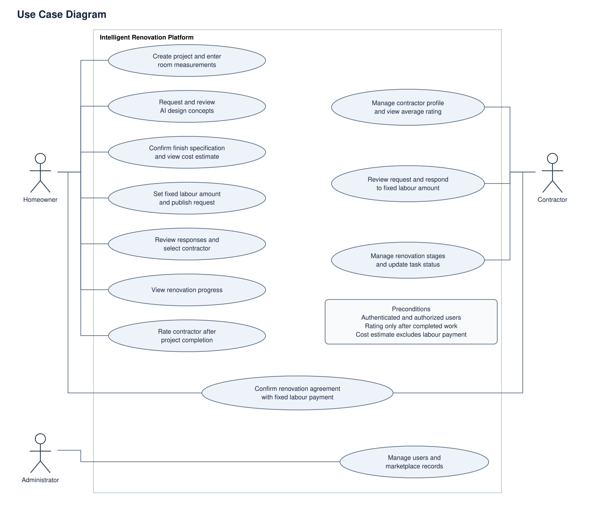
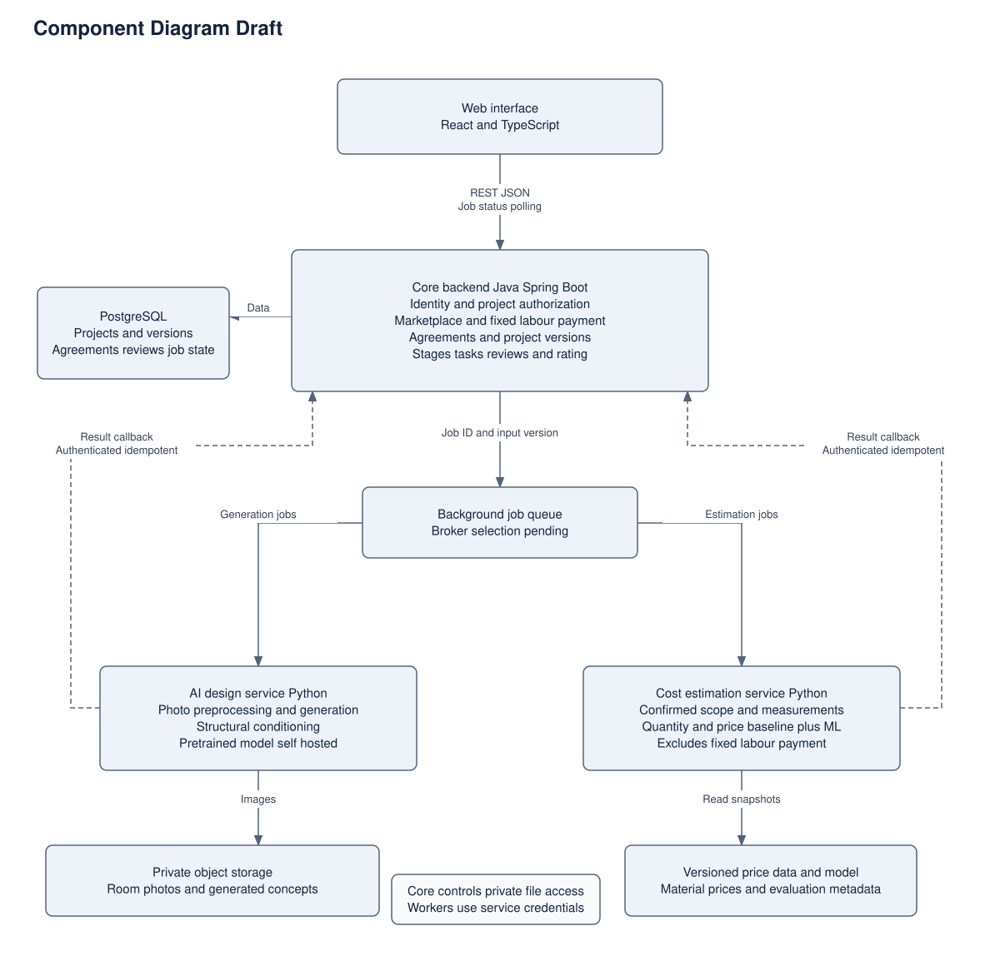

# 7. Architecture and Diagrams

Figure 1.1

1.1. System Context Diagram

The diagram (figure 1.1) defines the platform’s boundary and its interactions with three user roles: homeowner, contractor, and administrator. Homeowners provide room photos, measurements, and a fixed labour amount, while contractors respond to requests and report progress. The platform connects AI design, cost estimation, agreements, and renovation monitoring. Contractor labour payment is separate from the cost estimate.

Figure 1.2

1.2. Use Case Diagram

The diagram (figure 1.2) presents the main functions available to each role. Homeowners create projects, approve designs and specifications, view estimates, select contractors, monitor progress, and rate completed work. Contractors manage their profiles, respond to requests, and update renovation tasks. Both parties confirm the agreement, while administrators manage users and marketplace records.

Figure 1.3

1.3. Component Diagram

The diagram shows the proposed internal architecture. A React interface communicates with the Spring Boot backend, which manages business processes and stores structured data in PostgreSQL. A background queue distributes tasks to separate Python services for design generation and cost estimation. Images are stored in private object storage, while versioned inputs and results support traceability between modules.
