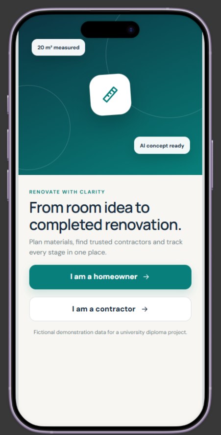
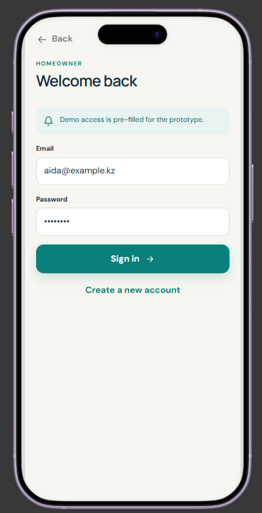
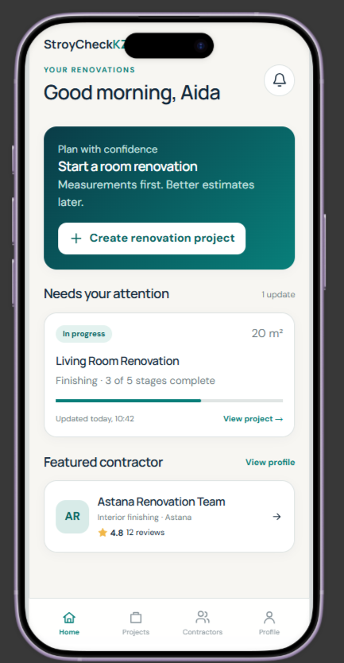
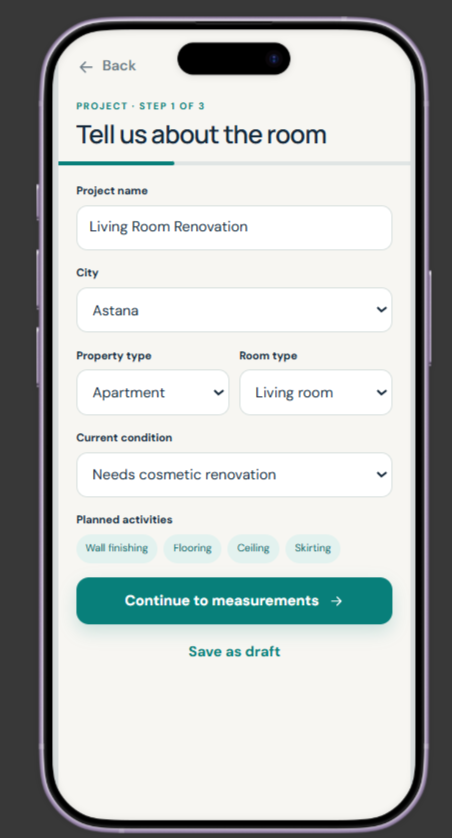
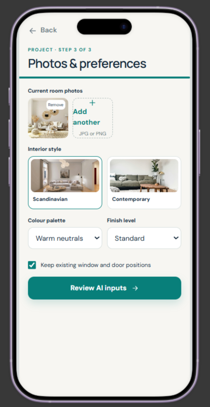
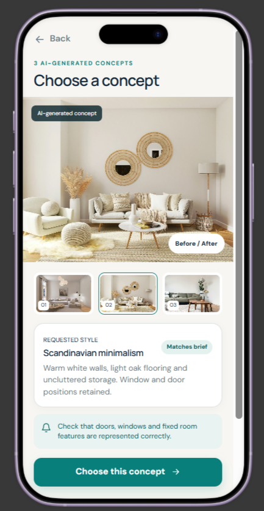
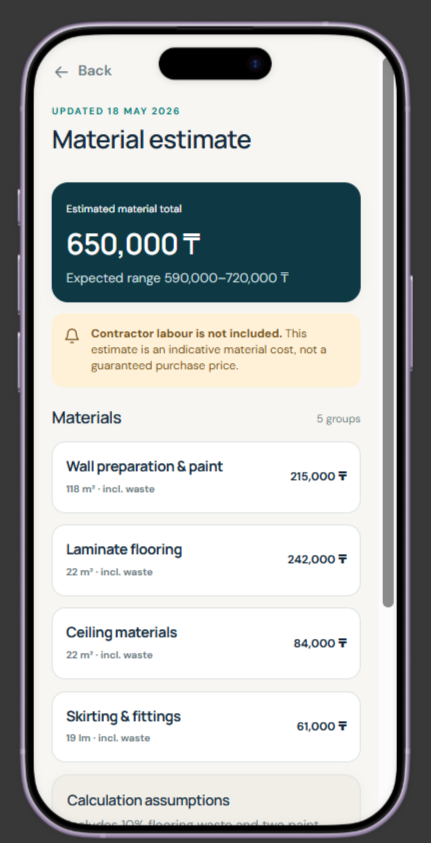
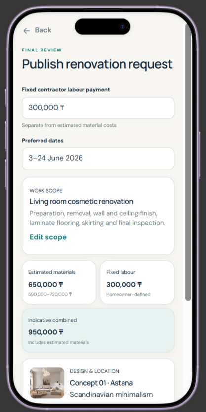
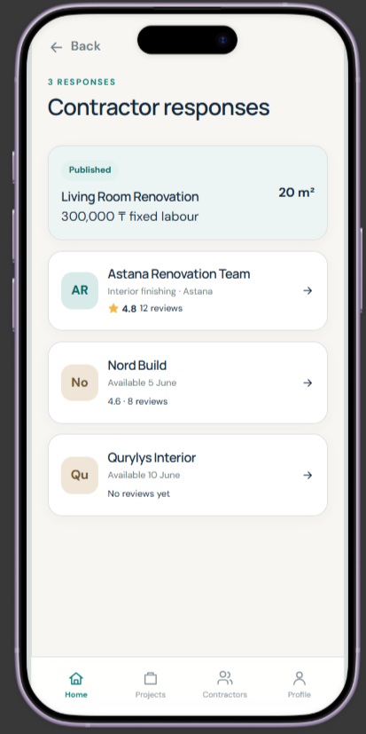
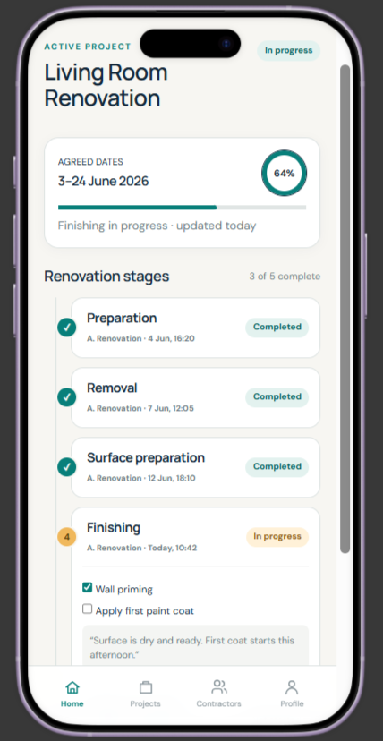

# Prototype Documentation

## Role selection.
This entry screen lets the viewer switch between the homeowner and contractor experiences. It supports demonstration of both sides of the workflow within one prototype.

## Homeowner Flow

### Authentication

### Homeowner home.
The home screen shows active projects with their current statuses and highlights a project that requires attention.

### Create project
- Project information: The first step collects the project name, city, property type, room type, current condition, and planned renovation activities.
- Measurements: Users enter length, width, and height in metres, plus optional door and window sizes. The floor area is calculated automatically, and short hints explain why measurements matter.
- Photos and preferences: Users upload room photos with previews and delete controls, then select an interior style, colour preferences, finish level, and constraints. A draft can be saved at any point.

### AI generation

### Material estimate.
The screen shows the estimated material total, the cost range, and the price reference date.

### Set labour amount and publish request.

### Request details and contractor responses.

### Agreement review and project progress.

